# 稚签 ZHIQIAN · 搜索、书签与工作台

> 状态：**v0.8.1 HTML 原型 + v1.1.2 MV3 扩展**（个人资料 / 新手引导 / 同步码 / 首页布局 / 待办提醒 / 摘录阅读 / 归档 / 真实 WebDAV）
> 默认风格：**午夜玻璃**（深色）；可在左下角四个圆点或设置里切换。
> 起点：妙书签 5.13.8（机制拆解）+ Infinity 新标签页（体验参考）+ GitHub 开源项目（架构参考）。

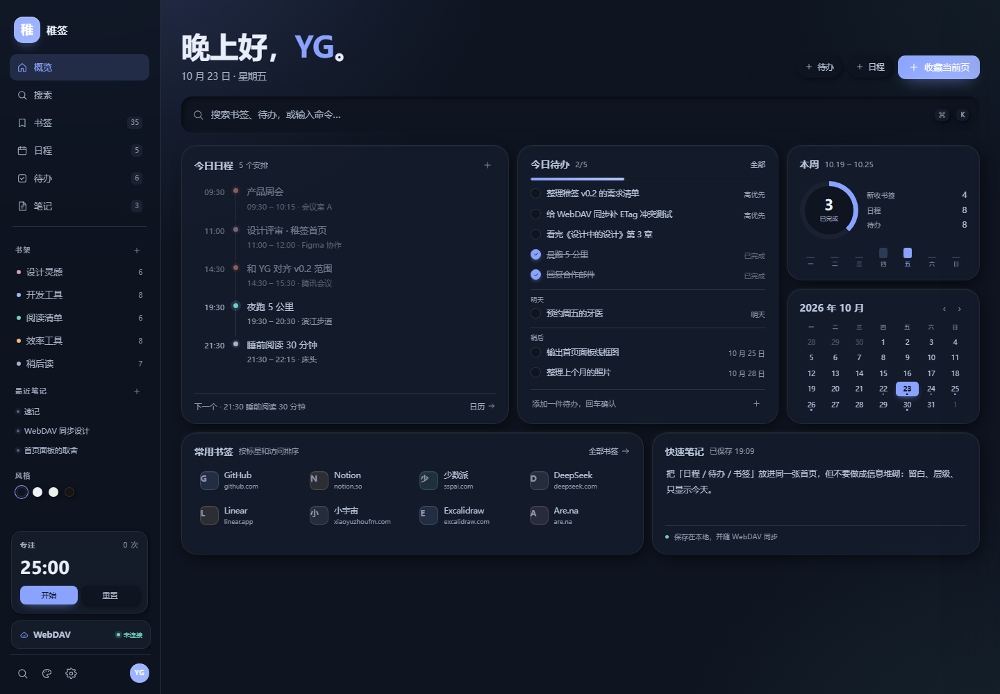

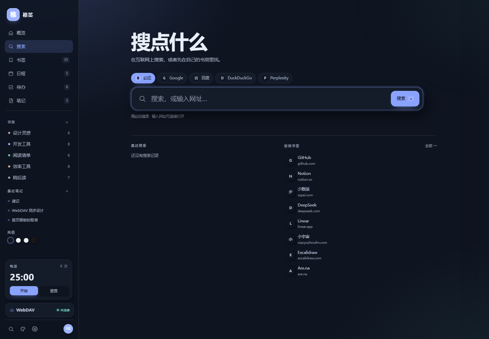

### 扩展版

首次启动先走一页新手引导：名字、底色、皮肤；同步可以稍后。引导结束后是空工作台，只保留欢迎笔记、速记和 3 个空书架。

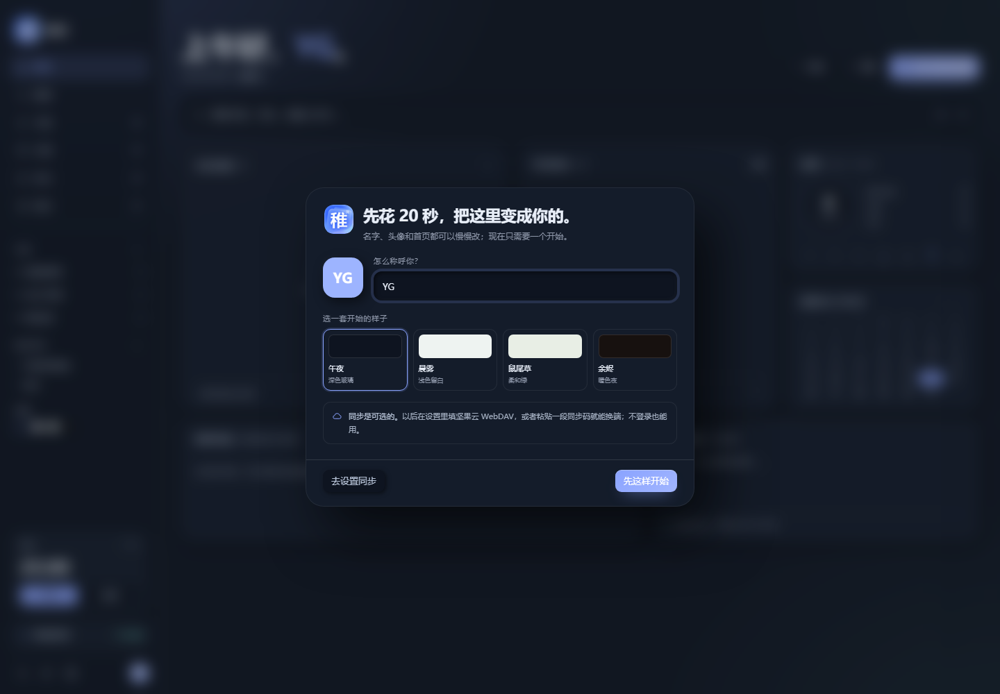

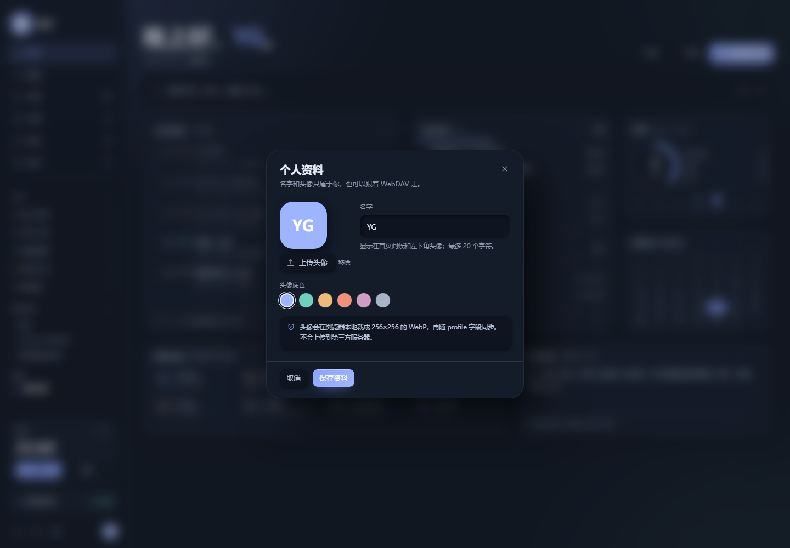

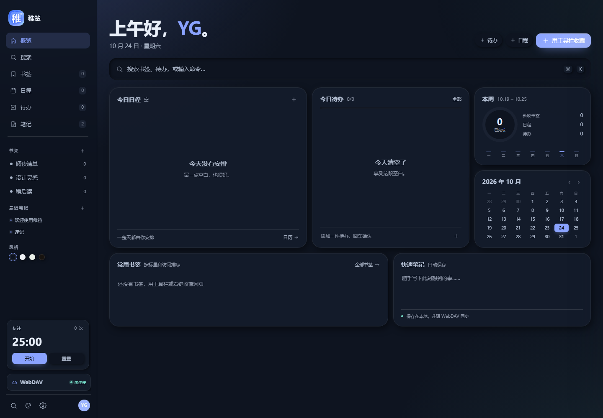

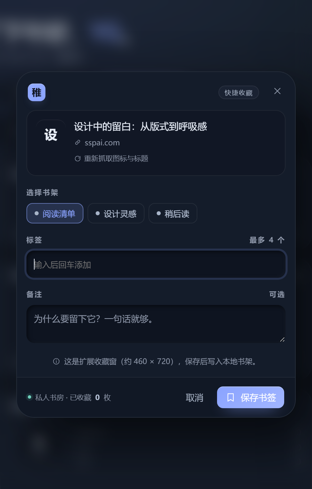

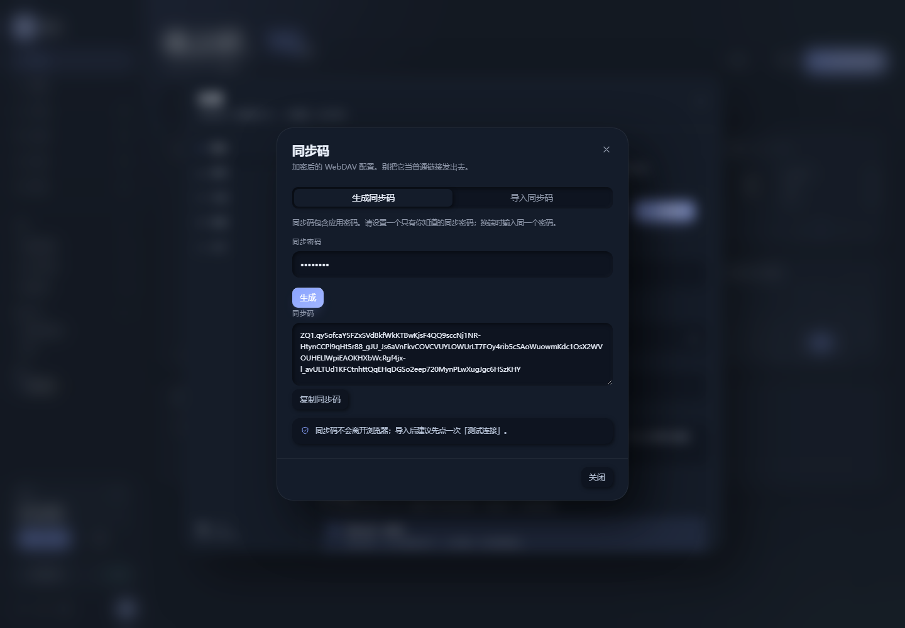

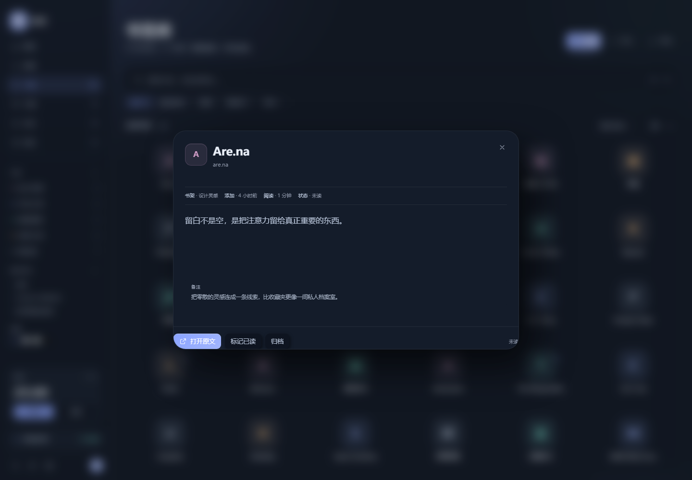

---

## 0. v1.1 · 个人资料、同步码与阅读

- **个人资料**：名字、头像上传/居中裁剪/256 WebP 压缩、底色；首页问候和左下角头像一起变
- **新手引导**：首次启动设置名字、底色和皮肤；同步可以稍后
- **同步码**：AES-GCM + PBKDF2 加密 WebDAV 配置，换端粘贴 ZQ1 码 + 同步密码即可
- **profile 进同步**：schema 4，名字和头像跟着 WebDAV 走
- **启动页**：打开新标签页先到概览还是搜索，设置里切换，立即持久化
- **首页布局**：完整 / 安静 / 专注；安静隐藏周统计和月历，专注只留待办和速记
- **待办提醒**：日期时间、到点浏览器通知、已过提醒标记
- **稍后读 / 归档**：书签摘录、阅读器、已读、归档筛选；摘录参与搜索
- **阅读器不是全文抓取**：当前是摘录 + 备注 + 原文入口；全文归档留下一版

## 0.1 v0.7 · 搜索页与稚签

- **品牌改为「稚签」**：界面、标题、收藏窗、导出文件名、默认 WebDAV 目录都换成 zhiqian；旧 localStorage 会自动迁移，旧数据不丢
- **新增独立搜索页**：左侧栏第二项「搜索」；不是弹窗，是一整页
- **搜索引擎切换**：必应 / Google / 百度 / DuckDuckGo / Perplexity，选择会记住
- **搜索框同时搜两个地方**：输入后先给「书房里」的书签、待办、笔记结果，回车再用当前引擎搜网页
- **网址直接打开**：输入 github.com 或 https://… 不经过搜索引擎，直接开新标签
- **搜索记录**：最近 8 条，可单条复用、可一键清空，跟着工作台一起持久化
- **常用书签**：搜索页下方放 8 个高频书签，不抢搜索框的主焦点
- **移动端 7 项底栏**：概览 / 搜索 / 书签 / 日程 / 待办 / 笔记 / 更多；专注和设置收进「更多」，既不遮挡内容，也不丢入口
- **快捷键**：⌘K 仍是快捷面板，/ 直接进搜索页

## 0.2 v0.6 · oil-ui 精修

安装了 [oil-ui](https://github.com/oil-oil/oil-ui) 0.23.9（本机路径 ~/.dsh/skills/oil-ui），按它的「存量项目优化 UI」流程做了一轮：留基线截图、从源头改变量、做真实视口检查，再交给一个没有上下文的评审者看一轮。

- **删掉标题上方的上下文条**：上一条「工作台 / 概览」是典型的眉标，和标题重复；现在页面直接从标题开始
- **日期并进副标题**：只留「10 月 23 日 · 星期五」，日程/待办数量回到各自卡片的 header，标题区不再是一段堆叠的说明
- **标题层级**：概览 42px / 页面 34px，字号回落后内容重新成为主角
- **阅读尺寸与对比度**：正文 13.5px 起，时间、状态、辅助信息提高到可读的对比度；今天标记改成深字浅底
- **书签库 6 列**：64px 图标，35 枚 + 新增格刚好填满 6 行，不再出现最后一排的空洞；标星从 6px 小点改成 12px 的明确标记
- **移动端 7 项底栏**：把「专注」放进底栏，移除悬浮番茄钟，不再遮住待办的状态字
- **日历**：非本月日期的存在感降到 22%，事件日状态统一
- **评审结论**：5 个问题里，移动端遮挡、次级文字对比度、标题层级、书签网格与日历状态都已处理；设置弹窗里的状态区、提示和日志保留内嵌表面，因为它们是功能分组，不是装饰

## 0.3 v0.5.1 视觉修订

- **新增顶部上下文条**：左边「工作台 / 当前页」，右边日期、天气；只在左边压一段 116px 短强调线，不再横贯整页
- **拆掉壁纸模式下的标题玻璃板**：原来标题会被一整块半透明的圆角板包住，字还贴着板边；现在标题直接落在背景上，和顶栏、搜索、卡片共用同一条左边缘
- **删掉每页重复的 eyebrow**：原来「书签库」出现两次，现在标题只出现一次，层级更干净
- **标题与操作按钮统一底部基线**：按钮不再浮在右上角，和大标题、副标题形成一条稳定的横线
- **页面切换淡入**：0.38s 轻微上移，不闪烁
- **卡片加 1px 细边 + 顶部高光**：深色下更像一块有厚度的玻璃，而不是纯色块
- **鼠标悬停轻抬**：桌面端卡片上浮 2px，阴影加深；触屏不受影响
- **主题切换过渡**：换皮肤时背景 / 文字 / 边框 0.32s 渐变，不再硬切
- **移动端短日期**：小屏显示「10.23 周五 · 晴 18°」，不再只剩一个孤立的点

## 0.4 v0.4 功能

- **恢复左侧栏**，去掉顶部导航；页面按钮放进各页页头，不再固定在顶栏
- **布局随窗口伸缩**：内容最大 1800px；窄屏时左栏收成 84px 图标栏，手机底部导航
- **周视图**：07:00–23:00 时间轴、7 天列、今天高亮；**直接拖动日程改日期和时间**（15 分钟对齐）
- **重复日程**：每天 / 工作日 / 每周 / 每月 + 重复截止
- **子任务**：待办里可增删、勾选子任务，列表显示 1/3 进度
- **重复待办**：完成后自动生成下一次，保留本次完成记录
- **番茄钟**：左栏常驻 25:00，支持开始 / 暂停 / 重置；移动端缩成圆形按钮，专注时展开
- **独立笔记页**：笔记列表 + 写作区 + 标签 + 字数 + 自动保存；首页速记同步到「速记」这篇
- **4 套风格**：午夜玻璃 / 晨雾 / 鼠尾草 / 余烬；左下角圆点或设置 → 外观切换
- **毛玻璃**：有壁纸时卡片、侧栏、搜索、弹窗磨砂；笔记编辑区保持实色，优先文字可读性
- **无壁纸也有氛围**：每套风格自带极低饱和的环境渐变，不再是一块死平色

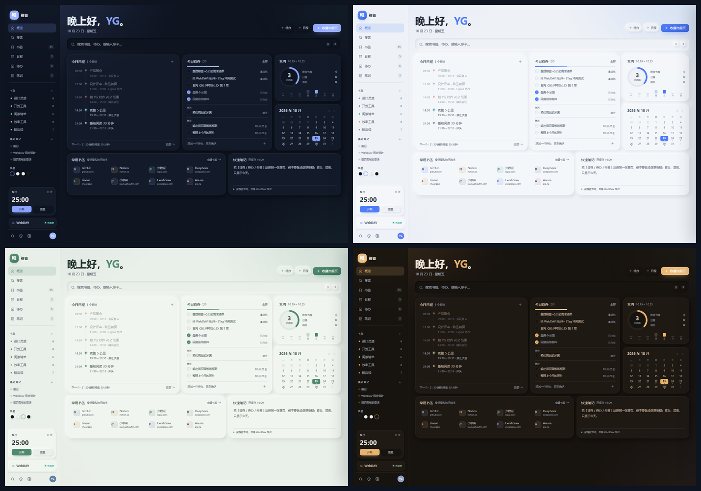

---

## 1. 设计方向：为什么是这四套

参考了 Catppuccin、Nord、Radix Colors、Tailwind Slate / Stone，以及 iA Writer、Linear 这类工具感界面。好用的工作台设计通常遵守这些约束：

1. **一个强调色**：只用于主按钮、选中态、关键数字，不大面积铺色。
2. **不用纯黑纯白**：深色底是带蓝或暖调的近黑，浅色底是带灰的纸白，长时间看不刺眼。
3. **8px 节奏**：间距、圆角、阴影都按同一套尺度走，界面才稳。
4. **正文对比度 ≥ 4.5:1**：笔记区尤其不能靠毛玻璃；所以写作面板是实色。
5. **阅读宽度 60–75 字符**：笔记正文固定 720px，16px / 1.95 行高，衬线字体。
6. **动效克制**：只保留 hover 抬升、弹窗淡入、计时器脉冲，不做无意义漂浮。

| 风格 | 底色 / 强调 | 气质 | 适合 |
| --- | --- | --- | --- |
| **午夜玻璃**（默认） | #0E1420 / #7D9BFF | 深蓝近黑、冷光 | 夜间、长时间写作 |
| **晨雾** | #EEF1F6 / #4F7CF7 | 冷灰纸白、干净 | 白天、办公室 |
| **鼠尾草** | #E9EFE9 / #4F8A6D | 灰绿、安静 | 阅读、低刺激 |
| **余烬** | #17130F / #E8A05A | 暖黑、琥珀 | 傍晚、偏暖屏 |

默认选午夜玻璃，是因为你提到深色可能更适合写作。如果白天用，晨雾或鼠尾草更轻松；四套都保留同一套布局，切换不改结构。

**写作文字**：界面用无衬线（Inter / 苹方 / 微软雅黑），笔记正文用宋体/思源宋体类衬线，16px、1.95 行高、720px 宽、实色底。这样 UI 清晰，正文有纸的感觉。

---

## 2. 布局与响应式

标题区现在是两层：**顶部上下文条**（工作台 / 页面 + 日期天气）和 **页面主标题**（大标题 + 副标题 + 右侧操作）。主标题和按钮按底部基线对齐；所有页面共用同一套节奏，不再各自漂移。

| 宽度 | 左栏 | 内容 |
| --- | --- | --- |
| > 1280 | 232–276px 完整侧栏 | Bento 12 栏；书签 8 列 |
| 1024–1280 | 84px 图标栏 | Bento 两栏；图标网格自适应 |
| 820–1024 | 84px 图标栏 | 两栏 / 单栏过渡 |
| < 760 | 隐藏侧栏 | 底部 7 项导航（搜索 / 更多）；双列图标；无悬浮遮挡 |

- 内容区最大 1800px，左右 padding 用 clamp，1440 下不再出现大片空白。
- 页头按钮 flex-wrap：窗口变窄时收藏 / 导入 / 导出 / 新建会自动换行。
- 书签网格 auto-fill + minmax(clamp(...))，不再写死列数；S/M/L 只改 tile 下限。
- 左栏最近笔记和风格圆点让侧栏不再空；番茄钟沉到底部。

---

## 3. 新功能细节

### 3.1 周视图与拖动

- 日历页右上角切换月 / 周。
- 周视图从 07:00 到 23:00，每小时 60px；事件按开始/结束绝对定位。
- 拖动事件：横向跨天、纵向改时间，15 分钟吸附；松手写回日期 / 开始 / 结束。
- 今天有一条强调色时间线；重复日程右上角有 ↻。
- 目前只做移动，还没做上下拉伸改时长；下一版可补 resize handle。

### 3.2 重复规则

- 日程：每天 / 工作日 / 每周 / 每月；可设重复截止。
- 渲染时按日期展开，月视图、周视图、议程、首页今日日程都走同一套 eventsOn 逻辑。
- 编辑重复日程默认编辑整个系列；单次例外（仅改这一次）留到下一版。
- 待办：完成后按频率生成下一次；子任务重置为未完成；原记录保留在已完成里。
- 月末边界（31 号）目前按同月同日匹配，短月会跳过；这是已知限制。

### 3.3 子任务

- 待办编辑弹窗里增删子任务、勾选完成。
- 列表显示子任务 1/3；完成后父任务不会自动完成，保留人为判断。
- 子任务目前是纯文本，不支持嵌套。

### 3.4 番茄钟

- 25 分钟专注 + 5 分钟休息；完成后自动切到休息，轮次 +1。
- 左栏卡片和弹窗共享同一个计时器；移动端默认缩成 44px 圆钮，运行时展开显示剩余时间。
- 计时状态不写入本地（刷新会回到 25:00）；轮次只存在当前会话。

### 3.5 笔记

- 左侧列表 + 右侧写作区；支持搜索、标签、字数、自动保存。
- 首页快速笔记编辑的是同一条 quick 笔记，不会出现两份内容。
- 笔记正文是纯文本；Markdown 渲染、双链、附件留到后续。
- 写作区在壁纸模式下仍是实色，不被毛玻璃干扰。

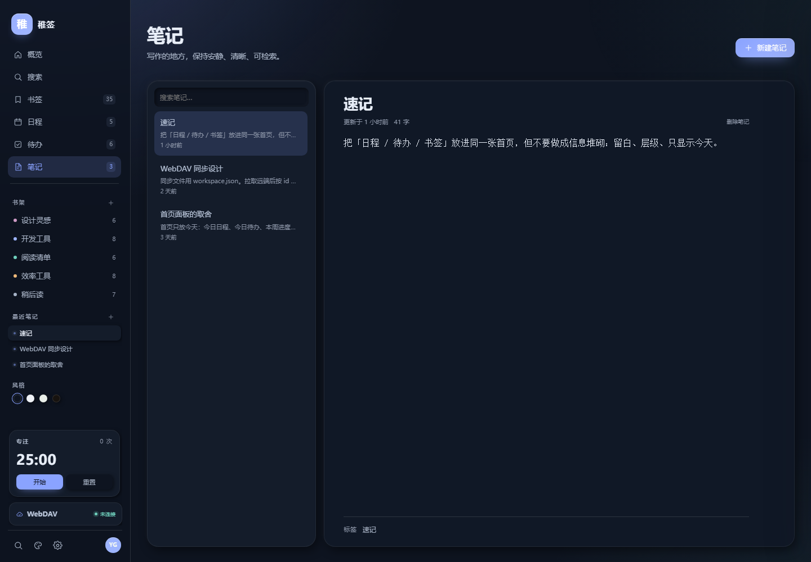

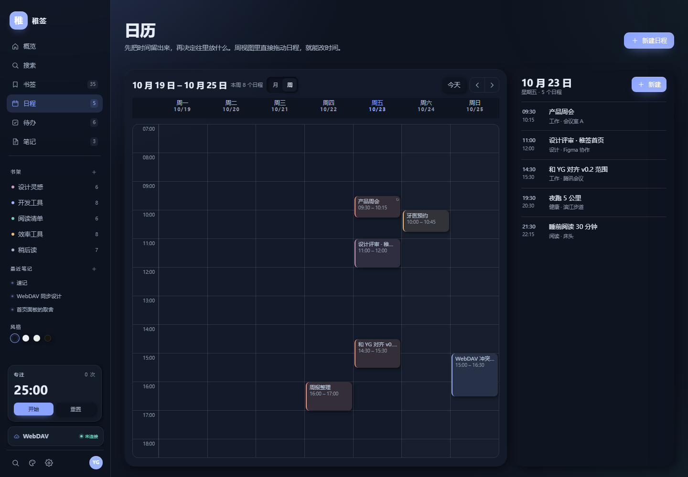

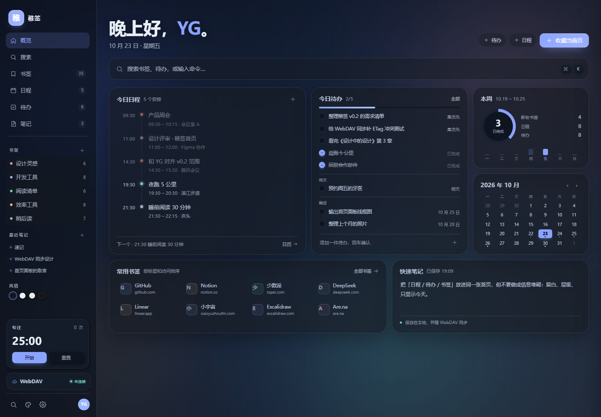

浅色壁纸下也一样：标题直接落在背景上，不再被整块玻璃板包住。

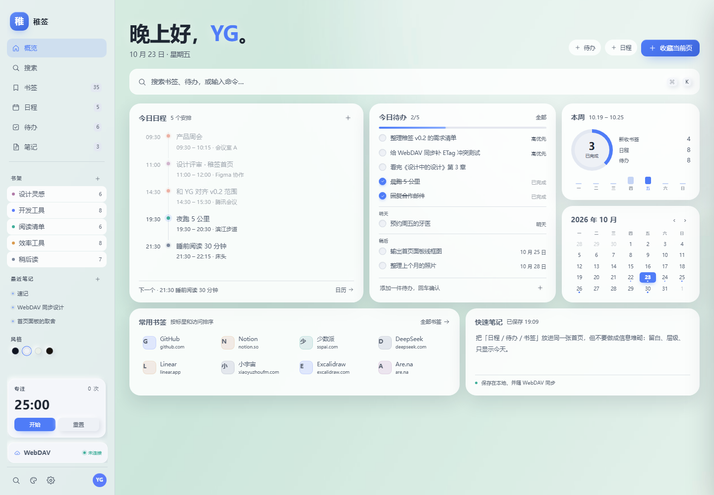

---

### 3.6 搜索页

- 左侧栏第二项进入，独立整页，不是弹窗。
- 五种引擎：必应 / Google / 百度 / DuckDuckGo / Perplexity；选择记在本地。
- 输入即出「书房里」的书签、待办、笔记；回车去网页搜索；输入域名或 URL 直接打开。
- 最近 8 条搜索记录 + 8 个常用书签，都可键盘或鼠标操作。
- 网页结果在搜索引擎自己的新标签页打开；原型不抓取网页内容。

## 4. 立即体验

**扩展版**：打开 edge://extensions 或 chrome://extensions → 开发人员模式 → 加载解压缩的扩展 → 选择 extension 目录。详见 [extension/README.md](extension/README.md)。打包副本在 [GitHub Releases](https://github.com/BadWanghaha/guzhihuan-zhiqian/releases/latest)。

**原型版**：双击 **prototype/index.html**（Chrome / Edge），离线可开。

| Hash | 界面 |
| --- | --- |
| 无 | 概览 |
| #search | 独立搜索页 |
| #settings | 设置 · WebDAV |
| #appearance | 设置 · 外观 / 壁纸 / 风格 |
| #data | 设置 · 数据 |
| #collect | 收藏弹窗 |
| #palette | 快捷搜索 |
| #dark | 午夜玻璃 |

快捷键：

- ⌘ / Ctrl + K 快捷面板
- / 打开搜索页并聚焦；N 新增书签；Esc 关闭浮层
- 拖动书签到左栏书架可归档

壁纸：

1. 设置 → 外观 → 背景 → 选预设；
2. 点上传选图；
3. 直接把图片拖进页面；调模糊 / 遮罩；右侧移除。

---

## 5. 坚果云 WebDAV：已接真请求

### 5.1 已完成

- 扩展的 background service worker 直接发 **PROPFIND / GET / PUT / MKCOL**，不受页面 CORS 限制
- 默认地址 **https://dav.jianguoyun.com/dav/**，远程路径 **/zhiqian/workspace.json**
- 坚果云域名已在 manifest 预授权；其它 WebDAV 域名第一次测试时按需申请
- Basic Auth 使用**应用密码**，不是登录密码
- ETag + If-Match 乐观锁；412 自动重试 ≤ 3 次；目录不存在时 MKCOL
- 合并：按 id 并集，updatedAt / createdAt 较新者胜出；两边相同时取本地
- profile 也进同步：名字、头像、底色跟着走
- 同步码：AES-GCM + PBKDF2 加密 URL/用户名/路径/应用密码，换端粘贴 ZQ1 码 + 同步密码
- 扩展目录里可以直接加载；原型里的测试连接 / 同步仍是交互演示

### 5.2 怎么用

1. 安装扩展，打开新标签页
2. 设置 → WebDAV
3. 填坚果云邮箱和应用密码，路径保持 /zhiqian/workspace.json
4. 点测试连接，成功后点立即同步
5. 首次同步会创建 zhiqian 目录和 workspace.json

换设备时也可以点「生成同步码」设置一个同步密码，复制 ZQ1 码；新设备导入后自动填好配置。自动同步只在新标签页打开时按间隔运行；关闭新标签页后不会后台跑。

### 5.4 同步文件草案

~~~json
{
  "app": "zhiqian",
  "schema": 4,
  "deviceId": "dev_xxx",
  "updatedAt": 1761052800000,
  "categories": [],
  "bookmarks": [],
  "events": [],
  "tasks": [],
  "notes": [],
  "profile": { "name": "YG", "avatar": "", "color": "indigo", "updatedAt": 0 }
}
~~~

- 壁纸不参与同步：它是设备偏好，文件也大；正式版存 IndexedDB。
- 书签带 read / archived / excerpt；待办带 remindAt / reminderSent。
- 删除暂时没有墓碑，跨设备删除不会传播。
- 笔记正文、子任务、repeat / repeatUntil 都在同一份 JSON 里。

---

## 6. GitHub 参考（stars 为 2026-10-21 查询）

| 项目 | Stars | 许可 | 借鉴点 |
| --- | ---: | --- | --- |
| [Tabliss](https://github.com/joelshepherd/tabliss) | 2.8k | GPL-3.0 | 小组件注册、开关、设置持久化 |
| [Bonjourr](https://github.com/victrme/Bonjourr) | 2.1k | GPL-3.0 | 极简排版、克制的设置面板 |
| [nightTab](https://github.com/zombieFox/nightTab) | 2.1k | GPL-3.0 | 本地配置、CSS 变量主题、书签网格 |
| [Glance](https://github.com/glanceapp/glance) | 37.6k | AGPL-3.0 | Bento 小组件布局、信息密度 |
| [Super Productivity](https://github.com/super-productivity/super-productivity) | 23.0k | MIT | 今日视图、任务元信息、时间盒 |
| [FullCalendar](https://github.com/fullcalendar/fullcalendar) | 20.7k | MIT | 周视图/拖拽交互参考 |
| [linkding](https://github.com/sissbruecker/linkding) | 11.3k | MIT | 标签/搜索/轻量书签模型 |
| [Linkwarden](https://github.com/linkwarden/linkwarden) | 20.2k | AGPL-3.0 | 收藏集合、阅读视图 |
| [Karakeep](https://github.com/karakeep-app/karakeep) | 29.9k | AGPL-3.0 | 统一收集入口、自动标签 |
| [floccus](https://github.com/floccusaddon/floccus) | 8.6k | MPL-2.0 | WebDAV 同步、冲突处理 |

GPL / AGPL / MPL 代码不能直接拷进闭源分发；这里只借鉴交互和架构，代码全部自写。

---

## 7. 妙书签（zip）的工作方式

1. Manifest V3，chrome_url_overrides.newtab → app/index.html，新标签页是完整 SPA。
2. 工具栏 popup 是创建网址表单：空间 → 分类 → 标题 → 网址 → 图标，保存到 websiteshare.cn/api。
3. 登录态存 chrome.storage.local.websiteAppToken；接口 URL 带 ct=extension&v=版本号。
4. 右键收藏至妙书签打开 460×720 的 collect.html，并传 sourceTabId。
5. 收藏窗口先 GET /tab/list 拉空间与分类，再展示页面预览。
6. background 创建后台标签页等 tabs.onUpdated 的 favIconUrl（10 秒超时），拿到后关标签页，并把图片域名重写到 image.websiteshare.cn。
7. theme.css 用 CSS 变量管理 16 套调色板；收藏窗口只取配色 token。
8. 空间、分类、书签全部在服务端，本地没有数据库。

稚签的方向：**本地优先 + 可选 WebDAV**，账号体系整个去掉。

---

## 8. 正式扩展（已生成）

~~~text
extension/
  manifest.json            # MV3，newtab override，工具栏 popup，右键菜单
  newtab.html              # 由 prototype/index.html 导出
  app.css / app.js         # 外置，满足 MV3 CSP
  background.js            # 右键菜单、收藏窗、WebDAV 消息
  webdav.js                # PROPFIND / GET / PUT / MKCOL、ETag、412 重试、合并
  popup.html/.css/.js      # 工具栏快速收藏
  icons/                   # 16 / 32 / 48 / 128
~~~

已生效的权限：

~~~json
{
  "permissions": ["storage", "unlimitedStorage", "tabs", "contextMenus", "notifications"],
  "host_permissions": ["https://dav.jianguoyun.com/*"],
  "optional_host_permissions": ["https://*/*", "http://*/*"],
  "chrome_url_overrides": { "newtab": "newtab.html" }
}
~~~

- 新标签页打开完整工作台；工具栏弹窗收藏当前页；右键菜单打开 460×720 收藏窗。
- 坚果云域名预授权；其它 WebDAV 域名第一次测试时按需申请。
- 脚本和样式全部外置，避免 MV3 拦截内联脚本。
- 数据仍在扩展自己的 localStorage；壁纸、搜索记录、皮肤不参与 WebDAV 同步。
- 自动同步和待办提醒只在新标签页打开时运行，没有后台 alarm。
- 新手引导、个人资料、同步码、启动页、首页布局、摘录阅读和归档已包含在 v1.1.2。
- 加载方式见 [extension/README.md](extension/README.md)。

---

## 9. 已知限制

- 周视图拖动只改时间/日期，不能上下拉伸改时长。
- 重复日程编辑整个系列；没有仅这一次的例外。
- 重复待办完成后生成下一次；两次勾选可能生成重复实例（原型未做幂等）。
- 番茄钟不持久化；刷新回到 25:00，轮次只在当前会话。
- 笔记是纯文本，不支持 Markdown、双链、附件。
- WebDAV 已在扩展里发真请求；删除没有墓碑，跨设备删除不会传播，下一次同步可能把旧条目带回来。
- 数据仍在扩展 localStorage，不是 IndexedDB；壁纸和头像数据大时可能触及配额。
- 阅读器是摘录 + 备注的轻阅读，不是全文抓取；全文归档需要下一版。
- 待办提醒只在页面打开时检查，没有后台通知。
- 自动同步只在新标签页打开时跑，关闭后没有后台 alarm。
- 没有文件夹/多页书签、自定义单站图标、Bing 每日一图。
- 天气是静态演示，不请求定位或天气 API。
- 搜索页不请求外部搜索建议 API；下拉里只有本地结果与搜索记录。网页结果在搜索引擎新标签页里打开。
- 原型是单文件 HTML（约 430KB）；扩展已拆成 newtab.html + app.css + app.js，但收藏窗仍加载完整工作台。

---

## 10. 需要你拍板

1. **搜索页**：默认用必应可以吗？还要不要 Google / 百度之外的引擎，或把结果做成多列？
2. **风格**：午夜 / 晨雾 / 鼠尾草 / 余烬，哪套最顺眼？默认继续午夜吗？
3. **左栏宽度**：现在完整 248px、窄屏 84px 图标栏；要不要更窄/更宽？
4. **周视图**：拖动改时间的手感可以吗？需不需要上下拉伸改时长、双击空白新建？
5. **重复规则**：编辑整个系列够用吗？要不要仅这一次 / 之后所有？
6. **笔记**：宋体 + 720px + 1.95 行高合适吗？要不要 Markdown / 专注模式？
7. **WebDAV**：扩展已经能真连；你填坚果云应用密码后，要不要我陪跑一次双设备冲突演示？
8. **Infinity 的其它能力**：文件夹/多页、自定义图标、每日一图，下一版先做哪个？

---

## 11. 下一步

扩展 v1.1.2 已经生成，可以加载：

**加载 extension → 新手引导 → 收藏当前页 → 右键收藏 → 坚果云测试连接 / 同步码 → 立即同步**

下一轮再做：IndexedDB 迁移、删除墓碑、后台 alarm 自动同步、全文归档、收藏窗轻量化。
